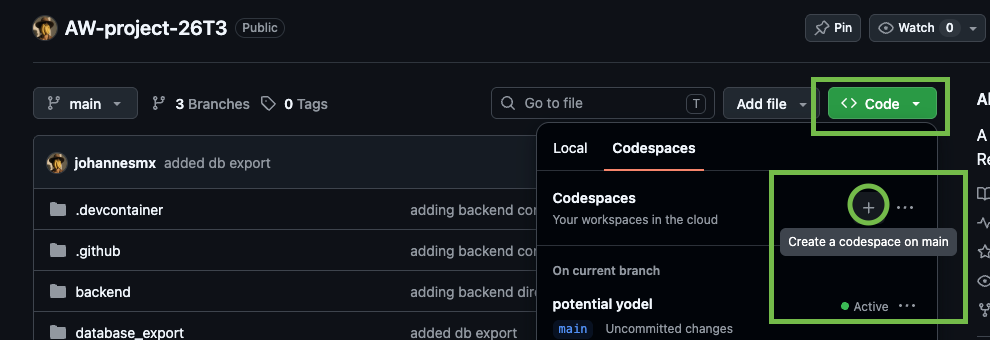

# How to use this project
- Fork this repository
- Create a Codespace on main
- Install the dependencies
- Add your data
- Run the backend
- Run the frontend

## Log in to Github and Fork the Repository
Log in to your Github account and create a fork of this repository. 


## Creating a Codespace
Click on the Green code button in your forked repository and under the Codespaces tab, click on "Create Codespace on main"


## Adding environment variables
Open the file called .env.sample in the .container directory, put in the details for your project.
- DB_DATABASE=database_name_for_your_application
- DB_USERNAME=username_for_your-application
- DB_PASSWORD=password_to_be_used_by_your_application
- DB_ROOT_PASSWORD=password_for_the_root_user_of_your_database (admin user)
After changing the details, you need to save the file as .env with no extension. When this is done, you need to rebuild the containers if you are using Github Codespaces.

After the containers have been rebuilt, open the other .env.sample file inside the backend directory and update the following:
- DBNAME=name_of_database_for_app (make it the same as DB_DATATABASE in the file above)
- DBUSER=name_of_database_user_for_app (make it the same as DB_DATATABASE in the file above)
- DBPASSWORD=database_password_for_app
- DBHOST=db

## Installing the dependencies
Once your Codespace has started, go to the Terminal tab at the bottom of the interface and it's now time to install the dependencies. 
### Frontend (React and Vite)
For the frontend and the frontend build system. Type the following command
```
npm install
```
### For the backend (PHP with Composer)
In the Terminal, navigate to the backend directory using
```
cd backend
```
Then we can install the backend dependencies using Composer
```
composer install
```
